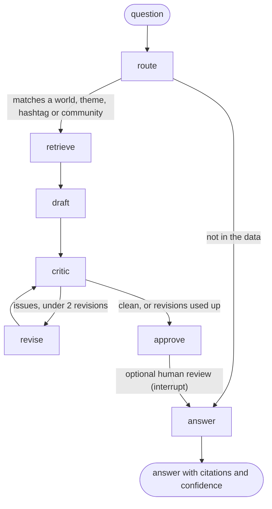

# Cultural Signal Agent

A LangGraph agent that answers questions about a brand-blind cultural signal tracker, and won't say more than the evidence supports.

Ask it *"What connects Gaming and Fashion?"* or *"Has #bulin47 been adopted by football fans?"* and it pulls the relevant part of the cultural map, drafts an answer, and sends every claim through an evidence critic before answering. A claim stronger than its evidence ("adopted", "verified community", "established movement") goes back for revision.

This is an independently built prototype by Krithika Chandrasekaran (Kinetic Five), running on a frozen snapshot of real data: TikTok Creative Center, TikTok One, Top Ads and published research, captured October to November 2026. It is not a production system.

## Why it exists

The tracker's first version was a chain of agents: web-search discovery → strategy mapping → community finding → narrative. Nothing in that chain checked the evidence, and the last step made the output more persuasive, not more accurate. Unsourced percentages and loose "this community adopted that trend" claims got through.

Reviewing the October data by hand (with a second model as reviewer) surfaced the same kinds of mistakes. Three examples: #bulin47 was called "adoption" when we had only seen the template in two worlds; "quiet life" was called an opportunity on the strength of two paid posts; and engagement rates on commercial posts were read as cultural signals.

This agent turns those lessons into rules the system enforces on every answer.

## How it works



| Node | What it does |
|---|---|
| **route** | Classifies the question: a world overview, a connection between two worlds, one hashtag or community, a theme, the community list, or not in the data. Rule-based, so routing is predictable and testable. |
| **retrieve** | Pulls the relevant slice of the map: top-100 ranks and climbers (Oct 22 → Nov 4), theme bridges, communities, placed hashtags, movements and the commercial layer. Each comes as a uniform evidence record. |
| **draft** | Writes claims. Each claim cites evidence ids and declares what it asserts. Uses Claude when `ANTHROPIC_API_KEY` is set; otherwise a rule-based baseline drafter, so the graph and the evals run with no key. |
| **critic** | Checks every claim against seven evidence rules (below). Rule-based on purpose, so the model that drafts doesn't grade itself. |
| **revise** | Fixes what the critic flagged: Claude rewrites from the issue list, or the baseline downgrades the wording. Capped at 2 loops; anything still unresolved is printed with the answer, never hidden. |
| **approve** | Optional human-in-the-loop pause (LangGraph `interrupt`, with a checkpointer). A reviewer approves or holds the answer. |
| **answer** | Renders each claim with its citations and confidence (placement/lead, traced, verified), says plainly when something isn't in the data, and adds a standing note that nothing is verified adoption. |

### The evidence rules (the critic)

| Rule | What fails |
|---|---|
| R1 Citation | A claim with no citation, or citing a record that wasn't retrieved (an invented id) |
| R2 Relationship | Asserting a stronger relationship than the evidence supports. The types, from weakest to strongest evidence: co-occurrence, shared meaning, **cross-world use observed**, adoption (verified: 5+ unrelated creators, dated), transmission |
| R3 Community | Calling a community verified when none meets the community test |
| R4 Movement | Calling something established without 2+ Tier 1–2 sources |
| R5 Commercial | A cultural claim that rests only on ads or creator partnerships |
| R6 Calendar | Calling a seasonal tag a trend |
| R7 Certainty | Certainty language ("definitely", "proves") on one month of data |

The critic reads the claim's wording as well as its declared assertions, and it handles negation: "not verified adoption" passes, "adopted" fails. So a drafter that under-declares what it's claiming is still caught.

### Design choices worth noting

- **Brand-blind by design.** The agent never sees a brand or brief. Brand fit belongs to a later agent; mixing it in here would bias discovery towards what a brand wants to hear.
- **A deterministic critic.** Evidence rules are policy, not opinion, so they're code. An LLM judge could be added for tone and usefulness, but not for whether a claim is supported.
- **Unresolved issues are shown, not hidden.** After two revisions, the answer ships with its open issues listed.
- **"Not in the data" is a correct answer.** The March pipeline surfaced "Painterly Realism" from web articles; this agent says it isn't in the tracker rather than inventing it.

## Evaluations

Two sets, in `evals/`:

1. **Critic traps** (`critic_traps.json`): 10 known overclaims, several taken from the October review, plus 5 correct claims that must *not* be flagged (so the critic isn't simply over-strict).
2. **Questions** (`questions.json`): 18 end-to-end questions. Each checks the routing, the evidence the answer must cite, wording it must or must not contain, and that the critic is clean at the end.

| Run | Critic: overclaims caught | Critic: clean claims passed | Questions passed |
|---|---|---|---|
| Run 1 (`results_run1.md`) | 10/10 | 5/5 | 16/18 |
| Run 2 (`results.md`) | 10/10 | 5/5 | **18/18** |

Run 1 failed two questions, Q07 *"What's moving in Sports?"* and Q11 *"What connects Music and Sports?"*. The router matched the word "sports" to the community *Sports bettors / pick-makers* and treated the questions as community lookups. The fix: world words name a world unless written as a hashtag (see `route` in `csa/nodes.py`). Three answers in run 2 went through a revision loop. In one of them the critic caught "spreading via footballers" in the tracker's own source notes, an overclaim that predated the agent.

These results are for the rule-based baseline drafter. With an API key set, the same evals run against Claude and the results file records which drafter was used.

## Run it

```bash
pip install -r requirements.txt
python -m csa "What's moving in Beauty?" --trace        # --trace prints each node's step
python -m csa "Tell me about #garba" --approve          # pauses for human approval
python evals/run_evals.py                               # writes evals/results.md

export ANTHROPIC_API_KEY=...                            # optional: Claude drafts and revises
export LANGSMITH_TRACING=true LANGSMITH_API_KEY=...     # optional: LangSmith tracing (not exercised in this build)
```

## Data

`data/` holds a frozen snapshot of the tracker: 113 placed hashtags, 12 themes, 37 movements, 9 cross-world bridges, 14 communities and audiences, 60 commercial-layer records, and Creative Center top-100 lists for five worlds on Oct 22 and Nov 4, 2026 (US, 30 days). No live scraping. Collection runs monthly in the tracker itself.

## Limits

- One month of data, TikTok-led. Most links are placements or traces; none is verified adoption yet.
- Routing is keyword-based. It handles the question types above, not open-ended questions.
- The baseline drafter is deliberately plain: one claim per record. The Claude drafter is the one meant for real use, and hasn't been evaluated in this build because no API key was available.
- Ranks aren't placed against the map automatically; the answer labels them "ranking only".

## Next

- Run the evals with the Claude drafter, and add usefulness checks (does the answer lead with what matters?).
- An LLM router as a fallback for questions the rules don't match.
- Monthly snapshots, so trajectory questions ("is cozy growing?") compare months.
- Connect it to the tracker dashboard's network view as its "Ask" box.
